# PRD: Sistem Rental Alat Musik

| Item | Keterangan |
|---|---|
| Versi dokumen | 1.1 (layar awal diubah: login dipilih per peran, Admin atau Penyewa) |
| Tanggal | 18 November 2026 |
| Mata kuliah | Praktikum Pemrograman Berorientasi Objek (UAS) |
| Kelompok | Kelompok 4 |
| Batas pengumpulan | Sabtu, 28 November 2026, pukul 11.00 (sebelum masuk lab) |
| Status | Final, siap diimplementasikan |

Dokumen ini adalah **acuan tunggal** pembuatan program. Jika ada perbedaan antara dokumen ini dan ingatan/percakapan lain, dokumen ini yang berlaku. Kata **WAJIB** berarti harus dipenuhi, **BOLEH** berarti opsional.

---

## 1. Ringkasan

### 1.1 Deskripsi
Sistem Rental Alat Musik adalah aplikasi **CLI (Command Line Interface)** berbahasa **Java** untuk mengelola penyewaan alat musik. Terdapat dua peran: **Admin** (mengelola barang dan memproses transaksi) dan **Penyewa** (melihat barang, menyewa, dan melihat riwayat). Data disimpan ke file `.txt` sehingga tidak hilang saat program ditutup.

### 1.2 Tujuan
1. Memenuhi seluruh requirement soal UAS Praktikum PBO "Rental System with Java".
2. Menerapkan konsep **Abstraction, Inheritance, Polymorphism, Encapsulation, Interface, Collection, Exception** dengan benar (target 30 poin source code).
3. Memiliki dokumentasi Javadoc, README, dan riwayat commit GitHub yang baik (target 20 poin).
4. Dapat didemokan lancar tanpa PPT (target 50 poin presentasi).

### 1.3 Anggota Kelompok

| No | Nama | NIM | Peran |
|---|---|---|---|
| 1 | Mohd Rian Maulana | 250810701100082 | Belum dibagi |
| 2 | Shelvya Pratiwi | 250810701100041 | Belum dibagi |
| 3 | Nur Asysyifa Nadhira | 250810701100060 | Belum dibagi |

- Untuk saat ini pengembangan dilakukan **oleh satu orang** tanpa pembagian modul. Jika pembagian peran diputuskan kemudian, perbarui tabel ini dan README.
- Sesuai soal, anggota yang tidak berkontribusi namanya **dicoret** dari README dan dari tabel ini sebelum pengumpulan.
- Tidak ada nama brand/toko. Teks yang tampil di banner dan invoice adalah "SISTEM RENTAL ALAT MUSIK" / "RENTAL ALAT MUSIK".

---

## 2. Ruang Lingkup

### 2.1 Termasuk (In Scope)
- Login dengan 2 akun hardcode (1 Admin, 1 Penyewa) dan logout.
- Admin: tambah, edit, hapus barang; lihat, terima, dan tolak transaksi; konfirmasi pengembalian dan hitung denda; lihat semua riwayat transaksi.
- Penyewa: lihat/cari/filter barang; keranjang sewa (banyak barang); buat transaksi dengan lama sewa dan metode pembayaran; lihat status transaksi dan batalkan transaksi menunggu; lihat riwayat sewa dan invoice.
- 3 kategori barang dengan cara hitung biaya berbeda, 3 metode pembayaran, denda per hari keterlambatan.
- Penyimpanan data ke file `.txt`.

### 2.2 Tidak Termasuk (Out of Scope)
- Registrasi akun baru, ubah password, banyak akun penyewa.
- Antarmuka grafis (GUI), web, atau database.
- Integrasi pembayaran sungguhan (semua pembayaran adalah **simulasi**).
- Pengembalian sebagian barang dalam satu transaksi (lihat BR-09).
- Stok lebih dari 1 unit per barang.
- Enkripsi password (password disimpan hardcode di kode untuk keperluan demo).

---

## 3. Pengguna dan Peran

| Peran | Username | Password | ID Akun | Nama tampil |
|---|---|---|---|---|
| Admin | `admin` | `admin123` | `ADM-001` | Administrator |
| Penyewa | `penyewa` | `penyewa123` | `PNY-001` | Penyewa Demo |

- Akun dibuat langsung di kode (`Main`) saat program mulai. Username dan password **case-sensitive**. Layar awal menyediakan pintu login terpisah untuk tiap peran (FR-01).
- Hanya ada **satu** akun penyewa, sehingga skenario "barang disewa penyewa lain" diwujudkan lewat **status barang** (sedang disewa tidak dapat disewa lagi), bukan lewat dua akun berbeda.

---

## 4. Keputusan Teknis dan Lingkungan

| Aspek | Keputusan |
|---|---|
| Bahasa | Java, versi terbaru: **JDK 27** (rilis September 2026). Kompilasi dengan `--release 27`. |
| Catatan versi | JDK 27 bukan LTS. JDK LTS terbaru adalah JDK 25. Pastikan komputer yang dipakai demo memiliki JDK 27. Jika tidak ada, ganti ke `--release 25` tanpa mengubah kode (kode **tidak boleh** memakai fitur preview). |
| Fitur Java modern | Boleh dan dianjurkan: `enum`, `switch` expression, text block untuk invoice, `java.time`, `var` secukupnya, Stream API untuk filter. **Dilarang** memakai fitur preview (`--enable-preview`). |
| Library | Hanya library standar JDK. Tanpa Maven/Gradle. |
| IDE | Bebas (IntelliJ IDEA, VS Code, NetBeans, Eclipse). Proyek harus dapat dibangun lewat `javac` biasa. |
| Package dasar | `com.rentalmusik` |
| Bahasa kode | **Bahasa Indonesia** untuk nama class, method, variabel, komentar, dan Javadoc (sesuai class diagram soal). Kata teknis baku Java (`get`, `set`, `main`, `toString`) tetap dalam bahasa Inggris. |
| Encoding | UTF-8 untuk source dan file data. |
| Tampilan CLI | Hanya karakter **ASCII** (`=`, `-`, `|`, `#`). Tanpa warna ANSI, tanpa clear screen, agar aman di Windows CMD/PowerShell. |
| Input | **Satu** objek `Scanner` bersama (di `InputHelper`) membaca `System.in`. Dilarang membuat `Scanner` baru di tempat lain. |
| Class diagram | PlantUML, ditulis langsung di dokumen ini (bagian 13). |

### 4.1 Perintah Build dan Jalankan

Linux/macOS:
```bash
mkdir -p out
javac --release 27 -encoding UTF-8 -d out $(find src -name "*.java")
java -cp out com.rentalmusik.Main
```

Windows PowerShell:
```powershell
New-Item -ItemType Directory -Force out | Out-Null
javac --release 27 -encoding UTF-8 -d out (Get-ChildItem -Recurse src -Filter *.java).FullName
java -cp out com.rentalmusik.Main
```

Generate Javadoc:
```bash
javadoc -encoding UTF-8 -charset UTF-8 -docencoding UTF-8 -d docs/javadoc -sourcepath src -subpackages com.rentalmusik
```

Program dijalankan dari **folder root proyek** karena folder `data/` dibuat relatif terhadap direktori kerja.

### 4.2 Struktur Proyek

```
rental-alat-musik/
├── README.md
├── PRD.md
├── .gitignore
├── src/com/rentalmusik/
│   ├── Main.java
│   ├── model/
│   │   ├── Akun.java              (abstract)
│   │   ├── Admin.java
│   │   ├── Penyewa.java
│   │   ├── Barang.java            (abstract)
│   │   ├── AlatPetik.java
│   │   ├── AlatPukul.java
│   │   ├── AlatTiup.java
│   │   ├── KategoriBarang.java    (enum)
│   │   ├── ItemSewa.java
│   │   ├── StatusTransaksi.java   (enum)
│   │   ├── Transaksi.java
│   │   └── Invoice.java
│   ├── service/
│   │   ├── DaftarBarang.java
│   │   ├── KeranjangSewa.java
│   │   ├── DaftarTransaksi.java
│   │   └── PenyimpananFile.java
│   ├── pembayaran/
│   │   ├── Pembayaran.java        (interface)
│   │   ├── TransferBank.java
│   │   ├── QRIS.java
│   │   └── Tunai.java
│   ├── exception/
│   │   ├── RentalException.java
│   │   ├── LoginGagalException.java
│   │   ├── BarangTidakDitemukanException.java
│   │   ├── BarangTidakTersediaException.java
│   │   ├── InputTidakValidException.java
│   │   ├── PembayaranGagalException.java
│   │   ├── TransaksiTidakValidException.java
│   │   └── PenyimpananException.java
│   ├── ui/
│   │   ├── MenuAdmin.java
│   │   └── MenuPenyewa.java
│   └── util/
│       ├── InputHelper.java
│       ├── FormatHelper.java
│       └── Konstanta.java
├── data/            (dibuat saat runtime, TIDAK di-commit)
├── docs/
│   ├── class-diagram.png
│   └── javadoc/
└── out/             (hasil kompilasi, TIDAK di-commit)
```

`.gitignore` berisi: `out/`, `data/`, `*.class`, `.idea/`, `.vscode/`, `*.iml`.

---

## 5. Konvensi dan Format

| Hal | Aturan |
|---|---|
| Mata uang | Ditampilkan `Rp` + angka dengan titik sebagai pemisah ribuan, **tanpa spasi dan tanpa desimal**. Contoh: `Rp20.000`, `Rp657.500`, `Rp0`. Nilai internal bertipe `double` (sesuai class diagram), tetapi semua nominal adalah bilangan bulat rupiah. |
| Tanggal tampil dan input | `dd-MM-yyyy`, contoh `24-11-2026`. Parsing **ketat**: `31-02-2026` ditolak. |
| Tanggal di file | ISO `yyyy-MM-dd`. Tanggal kosong ditulis `-`. |
| Tanggal kosong di layar | Ditampilkan `-`. |
| ID barang | `PTK-001` (Petik), `PKL-001` (Pukul), `TPU-001` (Tiup). Nomor 3 digit, diisi nol di depan. |
| ID transaksi | `TRX-0001` (4 digit). |
| Nomor invoice | `INV-` + 4 digit nomor transaksi yang sama. Transaksi `TRX-0001` memiliki invoice `INV-0001`. |
| Input ID | Tidak membedakan huruf besar/kecil. Sistem menormalkan ke huruf besar (`ptk-001` menjadi `PTK-001`). |
| Input y/n | `y`/`Y` = ya, `n`/`N` = tidak. Nilai lain dianggap `InputTidakValidException`. |
| Menu | Dipilih dengan angka. Pilihan di luar rentang menampilkan `Pilihan tidak valid.` lalu menu ditampilkan lagi. |
| Awalan pesan | `[OK]` sukses, `[GAGAL]` kesalahan, `[INFO]` informasi, `[PERINGATAN]` peringatan. |
| Lebar garis | 60 karakter untuk invoice, 50 karakter untuk menu dan banner. |

---

## 6. Data Master

### 6.1 Kategori dan Cara Hitung Biaya

Setiap kategori adalah subclass dari `Barang` dan meng-**override** `hitungBiaya(int hari)`.

| Kategori | Class | Biaya tambahan (flat per barang per transaksi) | Default | Rumus `hitungBiaya(hari)` |
|---|---|---|---|---|
| Petik | `AlatPetik` | Biaya Perawatan Senar | Rp5.000 | `tarifHarian x hari + biayaPerawatanSenar` |
| Pukul | `AlatPukul` | Biaya Angkut/Setup | Rp10.000 (Drum Set Rp50.000) | `tarifHarian x hari + biayaAngkutSetup` |
| Tiup | `AlatTiup` | Biaya Sanitasi Mouthpiece | Rp5.000 | `tarifHarian x hari + biayaSanitasi` |

- Biaya tambahan **dikenakan sekali per barang per transaksi**, bukan per hari.
- Alat spesifik (Gitar Akustik, Cajon, dst.) adalah **objek**, bukan class baru.

### 6.2 Data Awal Barang (Seed)

Dipakai hanya jika `data/barang.txt` belum ada. Stok tiap barang **1 unit**, status awal `tersedia = true`.

| ID | Nama | Kategori | Tarif/hari | Biaya tambahan |
|---|---|---|---|---|
| PTK-001 | Gitar Akustik | Petik | Rp50.000 | Rp5.000 |
| PTK-002 | Gitar Elektrik | Petik | Rp75.000 | Rp5.000 |
| PTK-003 | Bass | Petik | Rp75.000 | Rp5.000 |
| PTK-004 | Ukulele | Petik | Rp30.000 | Rp5.000 |
| PKL-001 | Drum Set | Pukul | Rp150.000 | Rp50.000 |
| PKL-002 | Cajon | Pukul | Rp35.000 | Rp10.000 |
| PKL-003 | Marakas | Pukul | Rp15.000 | Rp10.000 |
| PKL-004 | Tamborin | Pukul | Rp15.000 | Rp10.000 |
| PKL-005 | Xylophone | Pukul | Rp40.000 | Rp10.000 |
| TPU-001 | Saksofon | Tiup | Rp100.000 | Rp5.000 |
| TPU-002 | Seruling | Tiup | Rp20.000 | Rp5.000 |
| TPU-003 | Harmonika | Tiup | Rp25.000 | Rp5.000 |

Tarif di atas adalah estimasi dan **boleh diubah** sebelum implementasi final (cukup ubah seed).

### 6.3 Metode Pembayaran

| Kode | Nama tampil | Class | Biaya admin | Perilaku |
|---|---|---|---|---|
| `TRANSFER` | Transfer Bank | `TransferBank` | Rp2.500 | Menampilkan nomor rekening, menunggu ENTER |
| `QRIS` | QRIS | `QRIS` | Rp0 | Menampilkan kode QR berbentuk teks, menunggu ENTER |
| `TUNAI` | Tunai | `Tunai` | Rp0 | Meminta uang diterima, menghitung kembalian |

### 6.4 Konstanta Sistem (`util/Konstanta.java`)

| Konstanta | Nilai |
|---|---|
| `DENDA_PER_BARANG_PER_HARI` | 20000 |
| `LAMA_SEWA_MIN` | 1 |
| `LAMA_SEWA_MAKS` | 14 |
| `MAKS_PERCOBAAN_LOGIN` | 3 |
| `BIAYA_ADMIN_TRANSFER` | 2500 |
| `BIAYA_PERAWATAN_SENAR_DEFAULT` | 5000 |
| `BIAYA_ANGKUT_SETUP_DEFAULT` | 10000 |
| `BIAYA_SANITASI_DEFAULT` | 5000 |
| `TARIF_MIN` | 1000 |
| `TARIF_MAKS` | 10000000 |
| `BIAYA_TAMBAHAN_MAKS` | 10000000 |
| `PANJANG_NAMA_MAKS` | 30 |
| `FOLDER_DATA` | `data` |
| `REKENING_TRANSFER` | `Bank Nusantara - 1234567890 a.n. Rental Alat Musik` |

Tidak ada batas jumlah barang di keranjang maupun per transaksi.

---

## 7. Aturan Bisnis

| ID | Aturan |
|---|---|
| BR-01 | Setiap barang berstok **1 unit**. Atribut `tersedia` bernilai `true` (tersedia) atau `false` (sedang disewa). |
| BR-02 | Barang dengan `tersedia = false` **tidak boleh** dimasukkan ke keranjang dan tidak boleh disertakan dalam transaksi baru. |
| BR-03 | Biaya sewa satu barang = `Barang.hitungBiaya(lamaSewa)` sesuai kategori (bagian 6.1). Perhitungan **wajib** dipanggil secara polimorfik lewat tipe `Barang`. |
| BR-04 | Satu transaksi memiliki **satu** lama sewa (1 sampai 14 hari) yang berlaku untuk semua barang di dalamnya. |
| BR-05 | `Subtotal` = jumlah biaya sewa semua barang. `Total tagihan` = `Subtotal` + biaya admin metode pembayaran. |
| BR-06 | Pembayaran **total tagihan** dilakukan **saat transaksi dibuat** oleh penyewa. Jika pembayaran gagal/dibatalkan, transaksi **tidak dibuat** dan keranjang tidak berubah. |
| BR-07 | Saat dibuat, status transaksi adalah `MENUNGGU`. Barang **belum** dikunci. Pada saat admin menerima transaksi, sistem memeriksa ulang bahwa semua barang masih ada dan tersedia. |
| BR-08 | Saat admin **menerima**: status transaksi menjadi `DISEWA`, semua barang menjadi `tersedia = false`, `tanggalSewa` = tanggal sistem hari itu, `tanggalJatuhTempo` = `tanggalSewa` + `lamaSewa` hari, lalu invoice dicetak. |
| BR-09 | Pengembalian dikonfirmasi untuk **seluruh barang dalam transaksi sekaligus** (tidak ada pengembalian sebagian). |
| BR-10 | Hari terlambat = `max(0, selisih hari antara tanggalJatuhTempo dan tanggalKembali)`. Mengembalikan tepat pada hari jatuh tempo **tidak** terlambat. |
| BR-11 | Denda = `hariTerlambat x jumlahBarang x Rp20.000`. Denda dibayar **tunai di tempat** saat konfirmasi pengembalian, dan dicatat di invoice akhir. |
| BR-12 | Saat admin konfirmasi pengembalian: status menjadi `SELESAI`, `tanggalKembali` terisi, semua barang kembali `tersedia = true`, lalu invoice akhir dicetak. |
| BR-13 | Admin dapat **menolak** transaksi `MENUNGGU`: status `DITOLAK`, barang tidak berubah, pembayaran dianggap batal/dikembalikan (simulasi, hanya dicatat lewat pesan). |
| BR-14 | Penyewa dapat **membatalkan** transaksinya sendiri selama status `MENUNGGU`: status `DIBATALKAN`, pembayaran dianggap dikembalikan (simulasi). |
| BR-15 | Transisi status yang sah hanya: `MENUNGGU` ke `DISEWA`, `DITOLAK`, atau `DIBATALKAN`; dan `DISEWA` ke `SELESAI`. Status `SELESAI`, `DITOLAK`, `DIBATALKAN` bersifat akhir. Transisi lain memunculkan `TransaksiTidakValidException`. |
| BR-16 | Admin boleh **menghapus** barang hanya jika `tersedia = true` **dan** barang tidak tercantum di transaksi berstatus `MENUNGGU`. Admin boleh **mengedit** barang kapan saja. |
| BR-17 | Data transaksi menyimpan **snapshot** barang (id, nama, kategori, tarif, biaya tambahan, biaya total) saat dibuat. Mengedit/menghapus barang setelahnya **tidak** mengubah transaksi lama. |
| BR-18 | **Riwayat sewa** penyewa = transaksi miliknya dengan status `DISEWA` atau `SELESAI` (yaitu yang sudah diterima admin). Transaksi `MENUNGGU`, `DITOLAK`, `DIBATALKAN` tampil di menu "Status Transaksi Saya", bukan di riwayat. |
| BR-19 | Invoice dicetak **dua kali**: (a) saat admin menerima transaksi (invoice sewa), dan (b) saat pengembalian dikonfirmasi (invoice akhir, memuat denda). Penyewa dapat mencetak ulang invoice dari menu Riwayat Sewa. |
| BR-20 | Tanggal kembali diinput **manual** oleh admin dan boleh setelah hari ini (untuk simulasi denda saat demo). Tanggal kembali **tidak boleh sebelum** `tanggalSewa`. |
| BR-21 | Nomor transaksi hanya bertambah setelah pembayaran berhasil (tidak ada nomor yang terlewat karena pembayaran gagal). |

### 7.1 Diagram Status Transaksi

```
                 +--> DISEWA --(konfirmasi kembali)--> SELESAI
                 |   (admin terima)
   MENUNGGU -----+
                 +--> DITOLAK     (admin tolak)
                 +--> DIBATALKAN  (penyewa batalkan)
```

### 7.2 Contoh Perhitungan

Penyewa menyewa **Gitar Akustik** dan **Drum Set** selama **3 hari**, bayar **Transfer Bank**. Diterima 19-11-2026, jatuh tempo 22-11-2026, dikembalikan 24-11-2026.

| Komponen | Perhitungan | Hasil |
|---|---|---|
| Gitar Akustik | 50.000 x 3 + 5.000 | Rp155.000 |
| Drum Set | 150.000 x 3 + 50.000 | Rp500.000 |
| Subtotal | 155.000 + 500.000 | Rp655.000 |
| Biaya admin Transfer | tetap | Rp2.500 |
| **Total tagihan** | 655.000 + 2.500 | **Rp657.500** |
| Hari terlambat | 24-11 dikurangi 22-11 | 2 hari |
| Denda | 2 hari x 2 barang x 20.000 | Rp80.000 |
| **Total akhir** | 657.500 + 80.000 | **Rp737.500** |

---

## 8. Persyaratan Fungsional

Format: Aktor, Prasyarat, Alur Utama, Alur Alternatif/Error, Hasil, Kriteria Penerimaan (KP).

### FR-01 Login
- **Aktor:** Admin, Penyewa. **Prasyarat:** program baru dijalankan atau setelah logout.
- **Layar awal:**
  ```
  ==================================================
              SISTEM RENTAL ALAT MUSIK
  ==================================================
  1. Login sebagai Admin
  2. Login sebagai Penyewa
  3. Keluar
  Pilih menu [1-3]:
  ```
- **Alur utama:** pilih 1 (Admin) atau 2 (Penyewa). Sistem menampilkan `--- LOGIN ADMIN ---` atau `--- LOGIN PENYEWA ---`, lalu meminta `Username` dan `Password`. Sistem mencari akun dengan username yang sama persis (username di-`trim`, password **tidak** di-`trim`) **dan** berperan sama dengan peran yang dipilih, lalu memanggil `akun.login(username, password)`. Jika `true`, `akunAktif` diisi dan menu sesuai peran tampil dengan pesan `[OK] Login berhasil. Selamat datang, {nama} ({Admin|Penyewa}).`
- **Aturan peran:** akun hanya bisa login lewat pilihan perannya sendiri. Akun `penyewa` yang dipakai di pilihan 1 (Admin) tetap **gagal**, dan sebaliknya, dengan pesan yang sama seperti password salah.
- **Alternatif/Error:**
  - Username kosong, akun tidak ditemukan, atau password salah: `LoginGagalException` dengan pesan `[GAGAL] Username atau password salah. Sisa percobaan: {n}.` (pesan tidak menyebutkan mana yang salah).
  - Percobaan ke-3 gagal: `[GAGAL] Percobaan login habis. Program berhenti.` lalu program keluar dengan `System.exit(1)`.
  - Pilih 3: `[INFO] Terima kasih. Program selesai.` lalu program keluar normal.
- **Hasil:** `akunAktif` terisi. Hitungan percobaan di-reset tiap kali pengguna memilih salah satu Login dari layar awal.
- **KP:** pilihan 1 dengan `admin/admin123` membuka menu Admin; pilihan 2 dengan `penyewa/penyewa123` membuka menu Penyewa; `penyewa/penyewa123` di pilihan 1 gagal; `admin/admin123` di pilihan 2 gagal; 3 kali salah mengakhiri program; `Admin/admin123` (huruf besar) gagal.

### FR-02 Logout
- Menu Logout mengosongkan `akunAktif` dan kembali ke layar awal (FR-01) dengan pesan `[INFO] Anda telah logout.`
- Isi keranjang penyewa **tetap tersimpan di memori** selama program belum ditutup. Keranjang **tidak** disimpan ke file (hilang saat program ditutup).

### FR-03 Lihat Daftar Barang (Admin dan Penyewa)
- **Alur:** menampilkan semua barang terurut berdasarkan ID menaik, format tabel:
  ```
  ID        Nama                  Kategori  Tarif/Hari  Biaya Tambahan  Status
  --------  --------------------  --------  ----------  --------------  ---------
  PTK-001   Gitar Akustik         Petik       Rp50.000         Rp5.000  Tersedia
  PKL-001   Drum Set              Pukul      Rp150.000        Rp50.000  Disewa
  ```
  Format kolom `printf`: `%-8s  %-20s  %-8s  %10s  %14s  %-9s`. Status: `Tersedia` jika `tersedia = true`, `Disewa` jika `false`.
- Jika daftar kosong: `[INFO] Belum ada barang.`
- **KP:** 12 barang seed tampil, terurut PTK, PKL, TPU dalam urutan ID string menaik (`PKL-...` lebih dulu dari `PTK-...`, lalu `TPU-...`).

### FR-04 Cari dan Filter Barang (Penyewa; Admin memakai FR-03 saja)
Submenu di "Lihat Daftar Barang" milik Penyewa:
```
1. Semua barang
2. Hanya yang tersedia
3. Filter kategori
4. Cari berdasarkan nama
5. Kembali
```
- **3:** pilih kategori (1 Petik, 2 Pukul, 3 Tiup).
- **4:** input kata kunci (tidak boleh kosong); pencarian **mengandung** (contains) dan tidak membedakan huruf besar/kecil. Contoh `gitar` menemukan Gitar Akustik dan Gitar Elektrik.
- Hasil memakai format tabel FR-03. Jika tidak ada hasil: `[INFO] Tidak ada barang yang sesuai.`

### FR-05 Tambah Barang (Admin)
- **Alur:** Kelola Barang > Tambah. Input berurutan:
  1. Kategori: 1 Petik, 2 Pukul, 3 Tiup.
  2. Nama (1 sampai 30 karakter, tidak boleh mengandung `|`, `;`, `~`, tidak boleh sama dengan nama barang lain tanpa memperhatikan huruf besar/kecil).
  3. Tarif harian (bilangan bulat, 1.000 sampai 10.000.000).
  4. Biaya tambahan sesuai kategori (bilangan bulat 0 sampai 10.000.000). **ENTER kosong** = pakai default kategori (Rp5.000 / Rp10.000 / Rp5.000).
- ID dibuat otomatis: awalan kategori + (nomor terbesar yang ada pada awalan itu + 1), 3 digit. Contoh setelah `PTK-004` terbit `PTK-005`. Barang baru berstatus tersedia.
- **Hasil:** `[OK] Barang {ID} - {nama} berhasil ditambahkan.` dan data tersimpan.
- **Error:** input tidak valid memunculkan `InputTidakValidException`, operasi dibatalkan, kembali ke submenu.

### FR-06 Edit Barang (Admin)
- Input ID barang (`BarangTidakDitemukanException` jika tidak ada). Sistem menampilkan data saat ini lalu menanyakan `Nama baru`, `Tarif harian baru`, `Biaya tambahan baru`. **ENTER kosong** pada sebuah isian = nilai lama dipertahankan. Aturan validasi sama dengan FR-05.
- ID dan kategori **tidak dapat** diubah.
- **Hasil:** `[OK] Barang {ID} berhasil diperbarui.` Transaksi lama tidak berubah (BR-17).

### FR-07 Hapus Barang (Admin)
- Input ID barang. Sistem menampilkan data barang dan meminta konfirmasi `Yakin menghapus? (y/n)`.
- **Error:**
  - ID tidak ada: `BarangTidakDitemukanException`.
  - Barang sedang disewa atau tercantum di transaksi `MENUNGGU`: `BarangTidakTersediaException` dengan pesan `[GAGAL] Barang {nama} tidak dapat dihapus karena sedang disewa atau diajukan dalam transaksi.`
- **Hasil:** `[OK] Barang {ID} berhasil dihapus.` dan data tersimpan.

### FR-08 Tambah Barang ke Keranjang (Penyewa)
- Input ID barang.
- **Validasi berurutan:** ID ada (`BarangTidakDitemukanException`), barang tersedia (`BarangTidakTersediaException`: `[GAGAL] Barang {nama} sedang disewa dan tidak dapat dimasukkan ke keranjang.`), belum ada di keranjang (`InputTidakValidException`: `[GAGAL] Barang {nama} sudah ada di keranjang.`).
- **Hasil:** `[OK] {nama} ditambahkan ke keranjang. Isi keranjang: {n} barang.` Tidak ada batas jumlah.

### FR-09 Lihat dan Hapus Isi Keranjang (Penyewa)
- Menampilkan tabel barang di keranjang (kolom seperti FR-03 tanpa Status) dan estimasi biaya per barang untuk **1 hari** (`hitungBiaya(1)`) sebagai gambaran. Jika kosong: `[INFO] Keranjang kosong.`
- Submenu: `1. Hapus satu barang`, `2. Kosongkan keranjang`, `3. Kembali`.
- Hapus satu barang: input ID; jika tidak ada di keranjang, `BarangTidakDitemukanException` dengan pesan `[GAGAL] Barang {ID} tidak ada di keranjang.`
- Kosongkan keranjang meminta konfirmasi `(y/n)`.

### FR-10 Buat Transaksi Sewa (Penyewa)
- **Prasyarat:** keranjang tidak kosong (jika kosong: `[GAGAL] Keranjang kosong. Tambahkan barang terlebih dahulu.`).
- **Alur:**
  1. Sistem menampilkan isi keranjang.
  2. Input **lama sewa** (bilangan bulat 1 sampai 14).
  3. Sistem memeriksa tiap barang: masih ada dan masih tersedia. Jika tidak, `BarangTidakDitemukanException`/`BarangTidakTersediaException` dan operasi dihentikan.
  4. Sistem menampilkan rincian per barang (memakai `hitungBiaya(lamaSewa)`), `Subtotal`.
  5. Pilih metode pembayaran: `1. Transfer Bank`, `2. QRIS`, `3. Tunai`.
  6. Sistem menampilkan `Biaya admin` dan `TOTAL TAGIHAN`, lalu `Lanjutkan pembayaran? (y/n)`. `n` membatalkan operasi (keranjang tetap).
  7. Sistem memanggil `pembayaran.prosesPembayaran(totalTagihan)` (FR-11).
  8. Jika berhasil: transaksi dibuat dengan status `MENUNGGU`, `tanggalDibuat` = hari ini, disimpan ke file, nomor transaksi bertambah, **keranjang dikosongkan**.
- **Hasil:** `[OK] Transaksi {TRX-xxxx} berhasil dibuat dan menunggu persetujuan admin.`
- **Error:** `PembayaranGagalException`: `[GAGAL] Pembayaran gagal: {alasan}. Transaksi tidak dibuat.` Keranjang tetap utuh.

### FR-11 Proses Pembayaran
Dipanggil dari FR-10 dengan `jumlah` = total tagihan (sudah termasuk biaya admin).

| Metode | Tampilan dan perilaku |
|---|---|
| Transfer Bank | Cetak `--- PEMBAYARAN: TRANSFER BANK ---`, jumlah yang harus ditransfer, rincian `(sudah termasuk biaya admin Rp2.500)`, nomor rekening `Konstanta.REKENING_TRANSFER`. Tunggu ENTER (`Tekan ENTER setelah transfer dilakukan...`). Lalu cetak `[OK] Pembayaran Transfer Bank sebesar {jumlah} diterima.` |
| QRIS | Cetak `--- PEMBAYARAN: QRIS ---`, blok kode QR teks (di bawah), `Kode: QRIS-{TRX-xxxx}`, jumlah. Tunggu ENTER (`Tekan ENTER setelah pembayaran QRIS berhasil...`). Lalu `[OK] Pembayaran QRIS sebesar {jumlah} diterima.` |
| Tunai | Cetak `--- PEMBAYARAN: TUNAI ---` dan jumlah. Minta `Masukkan uang diterima (0 untuk batal): Rp`. Jika kurang dari jumlah: `[GAGAL] Uang kurang {selisih}. Coba lagi.` dan **ulangi** input. Input bukan angka: `[GAGAL] Input harus berupa angka bulat.` dan ulangi. Input `0`: lempar `PembayaranGagalException("Pembayaran tunai dibatalkan")`. Jika cukup: `[OK] Pembayaran tunai diterima. Kembalian: {kembalian}.` |

Blok kode QR (tetap, 7 baris):
```
#######  ##  #######
#     #  ## #     #
# ### # ##   # ### #
# ### #  # # # ### #
# ### # #  ## # ### #
#     # ## # #     #
####### # # # #######
```
Nomor transaksi pada kode QRIS adalah nomor **calon** transaksi (nomor berikutnya yang belum dikomit, lihat BR-21).

### FR-12 Lihat Transaksi Menunggu (Admin)
- Menu "Transaksi Menunggu" menampilkan tabel transaksi berstatus `MENUNGGU`:
  ```
  ID        Penyewa         Tgl Dibuat  Lama  Barang  Total Tagihan  Metode
  --------  --------------  ----------  ----  ------  -------------  -------------
  TRX-0001  Penyewa Demo    18-11-2026     3       2       Rp657.500  Transfer Bank
  ```
- Jika kosong: `[INFO] Tidak ada transaksi yang menunggu.`
- Admin memasukkan ID transaksi (atau `0` untuk kembali), sistem menampilkan detail (rincian barang) lalu submenu: `1. Terima`, `2. Tolak`, `3. Kembali`.
- ID yang bukan transaksi `MENUNGGU`: `TransaksiTidakValidException` dengan pesan `[GAGAL] Transaksi {ID} tidak ditemukan atau tidak berstatus menunggu.`

### FR-13 Terima Transaksi (Admin)
- **Alur:** `Admin.terimaTransaksi(Transaksi t)`:
  1. Periksa tiap barang pada transaksi masih ada di `DaftarBarang` dan `tersedia = true`. Jika ada yang tidak: `BarangTidakTersediaException` (`[GAGAL] Barang {nama} sudah tidak tersedia. Transaksi tidak dapat diterima; silakan tolak transaksi.`); status transaksi tetap `MENUNGGU`.
  2. Set semua barang `tersedia = false`.
  3. `t.mulaiSewa(LocalDate.now())`: status `DISEWA`, `tanggalSewa`, `tanggalJatuhTempo`.
  4. Simpan data.
  5. Cetak **invoice sewa** (FR-15).
- **Hasil:** `[OK] Transaksi {ID} diterima. Barang berstatus disewa.`
- **KP:** setelah diterima, barang tampil `Disewa` di FR-03 dan tidak bisa dimasukkan ke keranjang (FR-08); transaksi muncul di Riwayat Sewa penyewa.

### FR-14 Tolak Transaksi (Admin)
- Meminta konfirmasi `(y/n)`. Jika `y`: status `DITOLAK`, barang tidak berubah, data tersimpan, pesan `[OK] Transaksi {ID} ditolak. Pembayaran {total} dianggap dikembalikan.`

### FR-15 Cetak Invoice
Class `Invoice` menerima `Transaksi` dan mencetak dengan format berikut (lebar 60 karakter). Contoh untuk transaksi berstatus `SELESAI` dengan keterlambatan:

```
============================================================
                 INVOICE RENTAL ALAT MUSIK
============================================================
No. Invoice    : INV-0001
No. Transaksi  : TRX-0001
Penyewa        : Penyewa Demo
Status         : SELESAI
Tgl Transaksi  : 18-11-2026
Tgl Sewa       : 19-11-2026
Jatuh Tempo    : 22-11-2026
Tgl Kembali    : 24-11-2026
Lama Sewa      : 3 hari
Metode Bayar   : Transfer Bank
------------------------------------------------------------
1. Gitar Akustik (PTK-001) - Petik
   Rp50.000 x 3 hari                               Rp150.000
   Biaya Perawatan Senar                             Rp5.000
   Subtotal item                                   Rp155.000
2. Drum Set (PKL-001) - Pukul
   Rp150.000 x 3 hari                              Rp450.000
   Biaya Angkut/Setup                               Rp50.000
   Subtotal item                                   Rp500.000
------------------------------------------------------------
Subtotal sewa                                      Rp655.000
Biaya admin (Transfer Bank)                          Rp2.500
TOTAL TAGIHAN SEWA                                 Rp657.500
Denda (2 hari x 2 barang x Rp20.000)                Rp80.000
------------------------------------------------------------
TOTAL AKHIR                                        Rp737.500
============================================================
```

Aturan isi per status:

| Status | Perbedaan isi |
|---|---|
| `DISEWA` (invoice sewa) | `Tgl Kembali : -`. Baris Denda dan TOTAL AKHIR **tidak dicetak**. Ditambah baris `Catatan: denda Rp20.000 per barang per hari keterlambatan.` |
| `SELESAI` tanpa terlambat | Baris Denda dicetak sebagai `Denda (0 hari)` dengan nilai `Rp0`. TOTAL AKHIR = TOTAL TAGIHAN SEWA. |
| `SELESAI` terlambat | Seperti contoh di atas. |

Invoice dibuat dari data `Transaksi` (tidak disimpan ke file terpisah).

### FR-16 Konfirmasi Pengembalian dan Hitung Denda (Admin)
- **Alur:**
  1. Sistem menampilkan tabel transaksi berstatus `DISEWA` (kolom: ID, Penyewa, Tgl Sewa, Jatuh Tempo, Barang). Jika kosong: `[INFO] Tidak ada barang yang sedang disewa.`
  2. Admin input ID transaksi (`0` kembali). ID bukan `DISEWA` memunculkan `TransaksiTidakValidException`.
  3. Admin input **Tanggal kembali** (`dd-MM-yyyy`). Tidak boleh sebelum `tanggalSewa` (BR-20) dan harus tanggal valid.
  4. Sistem menghitung hari terlambat (BR-10) dan denda (BR-11), lalu menampilkan ringkasan: jatuh tempo, tanggal kembali, hari terlambat, jumlah barang, denda.
  5. Jika denda lebih dari 0: `Denda {x} harus dibayar tunai. Denda sudah diterima? (y/n)`. `n` membatalkan konfirmasi (tidak ada perubahan data). Jika denda 0, langkah ini dilewati.
  6. `Admin.konfirmasiKembali(t, tanggalKembali)`: status `SELESAI`, `tanggalKembali` terisi, semua barang `tersedia = true`, data tersimpan.
  7. Cetak **invoice akhir** (FR-15).
- **Hasil:** `[OK] Pengembalian transaksi {ID} dikonfirmasi. Barang kembali tersedia.`
- **KP:** transaksi 3 hari yang diterima 19-11-2026 (jatuh tempo 22-11-2026) dan dikembalikan 24-11-2026 menghasilkan denda sesuai jumlah barang x 2 hari x Rp20.000; dikembalikan 22-11-2026 atau lebih awal menghasilkan denda Rp0; input 18-11-2026 ditolak karena sebelum tanggal sewa.

### FR-17 Riwayat Sewa (Penyewa)
- Menampilkan transaksi miliknya berstatus `DISEWA` atau `SELESAI` (BR-18), terurut ID menaik: ID, Tgl Sewa, Jatuh Tempo, Tgl Kembali, Total, Status. Jika kosong: `[INFO] Belum ada riwayat sewa.`
- Penyewa dapat memasukkan ID transaksi untuk mencetak ulang invoice (FR-15), atau `0` untuk kembali.

### FR-18 Status Transaksi Saya dan Pembatalan (Penyewa)
- Menampilkan **semua** transaksi miliknya (semua status) dengan kolom ID, Tgl Dibuat, Total Tagihan, Status.
- Penyewa dapat memasukkan ID transaksi `MENUNGGU` untuk dibatalkan (konfirmasi `(y/n)`), atau `0` untuk kembali. Pembatalan sesuai BR-14: `[OK] Transaksi {ID} dibatalkan. Pembayaran {total} dianggap dikembalikan.`
- ID milik transaksi lain/bukan `MENUNGGU`: `TransaksiTidakValidException`.

### FR-19 Semua Riwayat Transaksi (Admin)
- Menampilkan **semua** transaksi semua status, terurut ID menaik: ID, Penyewa, Tgl Dibuat, Total Tagihan, Denda, Status. Jika kosong: `[INFO] Belum ada transaksi.`
- Admin dapat memasukkan ID untuk mencetak invoice (hanya untuk status `DISEWA`/`SELESAI`; selain itu tampil detail rincian tanpa format invoice) atau `0` untuk kembali.

### FR-20 Penyimpanan dan Pemuatan Data
Lihat bagian 11. Ringkas: data dimuat saat program mulai dan disimpan setiap ada perubahan.

---

## 9. Spesifikasi Menu CLI

### 9.0 Layar Awal dan Alur Login
```
==================================================
            SISTEM RENTAL ALAT MUSIK
==================================================
1. Login sebagai Admin
2. Login sebagai Penyewa
3. Keluar
Pilih menu [1-3]:
```
Alur:
```
Layar awal
  |-- 1 -> --- LOGIN ADMIN ---   -> username/password -> Menu Admin (9.1)
  |-- 2 -> --- LOGIN PENYEWA --- -> username/password -> Menu Penyewa (9.2)
  |-- 3 -> keluar program
```
Contoh login penyewa:
```
--- LOGIN PENYEWA ---
Username: penyewa
Password: penyewa123
[OK] Login berhasil. Selamat datang, Penyewa Demo (Penyewa).
```

### 9.1 Menu Admin
```
==================================================
           MENU ADMIN (Administrator)
==================================================
1. Kelola Barang
2. Transaksi Menunggu (Terima / Tolak)
3. Konfirmasi Pengembalian
4. Semua Riwayat Transaksi
5. Logout
Pilih menu [1-5]:
```
Submenu Kelola Barang:
```
1. Lihat Semua Barang
2. Tambah Barang
3. Edit Barang
4. Hapus Barang
5. Kembali
```

### 9.2 Menu Penyewa
```
==================================================
           MENU PENYEWA (Penyewa Demo)
==================================================
1. Lihat Daftar Barang
2. Tambah Barang ke Keranjang
3. Lihat / Hapus Isi Keranjang
4. Buat Transaksi Sewa
5. Status Transaksi Saya
6. Riwayat Sewa
7. Logout
Pilih menu [1-7]:
```

### 9.3 Aturan Umum Alur CLI
- Setiap menu diulang sampai pengguna memilih Logout/Kembali.
- Setiap operasi dibungkus `try-catch`. `RentalException` ditangkap di menu dan pesannya dicetak dengan awalan `[GAGAL]`; program **tidak boleh crash** karena input salah.
- Setelah operasi selesai, kembali ke menu pemanggil tanpa menunggu ENTER, kecuali di tempat yang secara eksplisit meminta ENTER (pembayaran Transfer/QRIS).
- Input tidak valid pada sebuah operasi **membatalkan operasi tersebut** dan kembali ke menu aktif, kecuali: pilihan menu (tampil ulang menu), login (hitung percobaan), dan Tunai (ulang input).
- Jika input ditutup (EOF/Ctrl+D), program mencetak `[INFO] Input ditutup. Program berhenti.` dan keluar.

---

## 10. Validasi Input

| Input | Aturan | Exception | Pesan |
|---|---|---|---|
| Pilihan menu | Bilangan bulat dalam rentang menu | (ditangani lokal) | `Pilihan tidak valid.` |
| Bilangan bulat | Harus angka bulat (tanpa huruf, desimal, titik/koma ribuan) | `InputTidakValidException` | `Input harus berupa angka bulat.` |
| Rentang angka | Sesuai konstanta | `InputTidakValidException` | `Nilai harus antara {min} dan {maks}.` |
| Lama sewa | 1 sampai 14 | `InputTidakValidException` | `Lama sewa harus antara 1 dan 14 hari.` |
| Tarif harian | 1.000 sampai 10.000.000 | `InputTidakValidException` | `Tarif harian harus antara Rp1.000 dan Rp10.000.000.` |
| Biaya tambahan | 0 sampai 10.000.000 | `InputTidakValidException` | `Biaya tambahan harus antara Rp0 dan Rp10.000.000.` |
| Nama barang | 1 sampai 30 karakter setelah `trim`, tanpa `\|`, `;`, `~`, unik (case-insensitive) | `InputTidakValidException` | `Nama barang tidak valid atau sudah ada.` |
| ID barang/transaksi | Tidak kosong; dinormalkan ke huruf besar | `BarangTidakDitemukanException` / `TransaksiTidakValidException` | Lihat tiap FR |
| Tanggal | Format `dd-MM-yyyy`, tanggal kalender valid | `InputTidakValidException` | `Format tanggal harus dd-MM-yyyy dan tanggal harus valid.` |
| Konfirmasi y/n | Hanya `y`, `Y`, `n`, `N` | `InputTidakValidException` | `Jawaban harus y atau n.` |
| Kata kunci pencarian | Tidak kosong setelah `trim` | `InputTidakValidException` | `Kata kunci tidak boleh kosong.` |

Semua input teks di-`trim` sebelum divalidasi, kecuali password.

---

## 11. Penyimpanan File

Folder `data/` dibuat otomatis jika belum ada. Semua file berencoding UTF-8, satu record per baris. Baris kosong dan baris berawalan `#` diabaikan saat dibaca.

### 11.1 `data/barang.txt`
```
# id|kategori|nama|tarifHarian|biayaTambahan|tersedia
PTK-001|PETIK|Gitar Akustik|50000|5000|true
PKL-001|PUKUL|Drum Set|150000|50000|false
TPU-001|TIUP|Saksofon|100000|5000|true
```
- `kategori` salah satu dari `PETIK`, `PUKUL`, `TIUP`. Nominal ditulis bilangan bulat. `tersedia` bernilai `true`/`false`.

### 11.2 `data/transaksi.txt`
```
# id|idPenyewa|status|lamaSewa|tglDibuat|tglSewa|tglJatuhTempo|tglKembali|kodePembayaran|items
TRX-0001|PNY-001|SELESAI|3|2026-11-18|2026-11-19|2026-11-22|2026-11-24|TRANSFER|PTK-001~Gitar Akustik~PETIK~50000~5000~155000;PKL-001~Drum Set~PUKUL~150000~50000~500000
```
- Pemisah kolom `|`. Pemisah item `;`. Pemisah atribut item `~`: `idBarang~nama~kategori~tarifHarian~biayaTambahan~biayaTotal`.
- `status` salah satu dari `MENUNGGU`, `DISEWA`, `SELESAI`, `DITOLAK`, `DIBATALKAN`. `kodePembayaran` salah satu dari `TRANSFER`, `QRIS`, `TUNAI`.
- Tanggal belum ada ditulis `-`.
- Biaya admin dan denda **tidak disimpan**; keduanya dihitung ulang dari `kodePembayaran` dan data tanggal (aturan BR-05 dan BR-11).

### 11.3 `data/counter.txt`
```
transaksiBerikutnya=2
```

### 11.4 Perilaku
| Kondisi | Perilaku |
|---|---|
| `barang.txt` tidak ada | Buat dari seed (bagian 6.2) dan tulis ke file. |
| `transaksi.txt` tidak ada | Mulai dengan daftar kosong. |
| `counter.txt` tidak ada | Hitung dari nomor transaksi terbesar + 1 (atau 1 jika kosong). |
| Baris rusak (kolom kurang, angka/tanggal/enum tidak valid, `idPenyewa` tidak dikenal) | Baris **dilewati** dengan `[PERINGATAN] Baris {n} di {file} diabaikan: {alasan}`; program tetap berjalan. |
| Gagal menulis/membaca file (IOException) | Dibungkus `PenyimpananException`; pesan `[GAGAL] Gagal menyimpan data: {alasan}`; program tidak crash. |
| Kapan menulis | Setiap operasi yang mengubah data (tambah/edit/hapus barang; ubah ketersediaan; buat/terima/tolak/batalkan/kembalikan transaksi) menulis ulang file terkait secara penuh. |

Saat transaksi dimuat, `Penyewa.riwayat` diisi ulang dari semua transaksi dengan `idPenyewa` miliknya.

---

## 12. Exception

Semua exception adalah **checked** dan turunan dari `RentalException extends Exception`.

| Class | Dilempar ketika | Contoh pesan |
|---|---|---|
| `LoginGagalException` | Username/password salah | `Username atau password salah. Sisa percobaan: 2.` |
| `BarangTidakDitemukanException` | ID barang tidak ada di `DaftarBarang` atau di keranjang | `Barang dengan ID PTK-099 tidak ditemukan.` |
| `BarangTidakTersediaException` | Barang sedang disewa saat masuk keranjang/transaksi/diterima; hapus barang yang tidak boleh dihapus | `Barang Drum Set sedang disewa dan tidak dapat dimasukkan ke keranjang.` |
| `InputTidakValidException` | Input angka/tanggal/nama/y-n tidak valid, duplikat di keranjang | `Input harus berupa angka bulat.` |
| `PembayaranGagalException` | Pembayaran tunai dibatalkan atau pembayaran gagal | `Pembayaran tunai dibatalkan.` |
| `TransaksiTidakValidException` | Transaksi tidak ditemukan/bukan status yang diminta; transisi status tidak sah; tanggal kembali sebelum tanggal sewa | `Tanggal kembali tidak boleh sebelum tanggal sewa (19-11-2026).` |
| `PenyimpananException` | Error baca/tulis file (membungkus `IOException`) | `Gagal menyimpan data barang: ...` |

Aturan: tangkap `NumberFormatException`, `DateTimeParseException`, dan `NoSuchElementException` **hanya** di `InputHelper` lalu ubah menjadi exception di atas. Dilarang memakai `catch (Exception e)` kosong atau menelan exception tanpa pesan.

---

## 13. Arsitektur dan Class Diagram

### 13.1 Prinsip
- **Pemisahan tanggung jawab:** `model` (data dan perhitungan), `service` (koleksi dan file), `pembayaran` (strategi pembayaran), `ui` (menu dan input), `util` (pembantu).
- **Input** hanya dibaca di `ui` dan `pembayaran` lewat `InputHelper`. **Output** boleh dicetak di `ui`, `pembayaran`, `Invoice`, dan method `lihat*` pada `Akun`.
- Mutasi data **wajib** lewat method service (`DaftarBarang`, `DaftarTransaksi`) yang memanggil `PenyimpananFile`.
- Method `kelolaBarang()` pada class diagram soal diwujudkan sebagai `Admin.tambahBarang`, `editBarang`, `hapusBarang`, ditambah submenu "Kelola Barang" di `MenuAdmin`.
- `Transaksi` menyimpan `ArrayList<ItemSewa>` (snapshot, BR-17), menggantikan `ArrayList<Barang>` pada diagram minimum soal. Pemanggilan polimorfik `hitungBiaya` tetap dilakukan di `Penyewa.buatTransaksi` saat membuat `ItemSewa` dari barang di keranjang.

### 13.2 Class Diagram (PlantUML)

Render dengan ekstensi PlantUML (VS Code/IntelliJ) atau situs plantuml.com, lalu simpan sebagai `docs/class-diagram.png` dan jadikan screenshot untuk pengumpulan.

```plantuml
@startuml
skinparam classAttributeIconSize 0
skinparam shadowing false

package model {
  abstract class Akun {
    - id: String
    - username: String
    - password: String
    - nama: String
    + login(username: String, password: String): boolean
    + getId(): String
    + getUsername(): String
    + getNama(): String
    + {abstract} getPeran(): String
  }

  class Admin {
    - daftarBarang: DaftarBarang
    - daftarTransaksi: DaftarTransaksi
    + tambahBarang(b: Barang): void
    + editBarang(id: String, nama: String, tarif: Double, biaya: Double): void
    + hapusBarang(id: String): void
    + lihatTransaksiMenunggu(): ArrayList<Transaksi>
    + terimaTransaksi(t: Transaksi): void
    + tolakTransaksi(t: Transaksi): void
    + konfirmasiKembali(t: Transaksi, tglKembali: LocalDate): void
    + lihatSemuaTransaksi(): ArrayList<Transaksi>
  }

  class Penyewa {
    - keranjang: KeranjangSewa
    - riwayat: ArrayList<Transaksi>
    - daftarBarang: DaftarBarang
    - daftarTransaksi: DaftarTransaksi
    + lihatBarang(): void
    + tambahKeKeranjang(idBarang: String): void
    + hapusDariKeranjang(idBarang: String): void
    + lihatKeranjang(): void
    + buatTransaksi(lamaSewa: int, p: Pembayaran): Transaksi
    + batalkanTransaksi(t: Transaksi): void
    + lihatRiwayat(): void
    + getRiwayat(): ArrayList<Transaksi>
  }

  abstract class Barang {
    - id: String
    - nama: String
    - tarifHarian: double
    - tersedia: boolean
    + {abstract} hitungBiaya(hari: int): double
    + {abstract} getKategori(): KategoriBarang
    + {abstract} getBiayaTambahan(): double
    + {abstract} setBiayaTambahan(biaya: double): void
    + {abstract} getNamaBiayaTambahan(): String
    # hitungBiayaDasar(hari: int): double
  }

  class AlatPetik {
    - biayaPerawatanSenar: double
    + hitungBiaya(hari: int): double
  }
  class AlatPukul {
    - biayaAngkutSetup: double
    + hitungBiaya(hari: int): double
  }
  class AlatTiup {
    - biayaSanitasi: double
    + hitungBiaya(hari: int): double
  }

  enum KategoriBarang {
    PETIK
    PUKUL
    TIUP
  }
  enum StatusTransaksi {
    MENUNGGU
    DISEWA
    SELESAI
    DITOLAK
    DIBATALKAN
  }

  class ItemSewa {
    - idBarang: String
    - namaBarang: String
    - kategori: KategoriBarang
    - tarifHarian: double
    - biayaTambahan: double
    - biayaTotal: double
  }

  class Transaksi {
    - id: String
    - penyewa: Penyewa
    - items: ArrayList<ItemSewa>
    - lamaSewa: int
    - tanggalDibuat: LocalDate
    - tanggalSewa: LocalDate
    - tanggalJatuhTempo: LocalDate
    - tanggalKembali: LocalDate
    - status: StatusTransaksi
    - pembayaran: Pembayaran
    + hitungSubtotal(): double
    + hitungBiayaAdmin(): double
    + hitungTotal(): double
    + hitungHariTerlambat(): int
    + hitungDenda(): double
    + hitungTotalAkhir(): double
    + ubahStatus(baru: StatusTransaksi): void
    + mulaiSewa(tanggal: LocalDate): void
    + selesaikan(tanggal: LocalDate): void
  }

  class Invoice {
    - transaksi: Transaksi
    - total: double
    - denda: double
    + cetakInvoice(): void
  }
}

package service {
  class DaftarBarang {
    - barang: ArrayList<Barang>
    - indeksId: HashMap<String, Barang>
    + tambahBarang(b: Barang): void
    + editBarang(id: String, nama: String, tarif: Double, biaya: Double): void
    + hapusBarang(id: String): void
    + cariById(id: String): Barang
    + cariByNama(kata: String): ArrayList<Barang>
    + filterTersedia(): ArrayList<Barang>
    + filterKategori(k: KategoriBarang): ArrayList<Barang>
    + ubahKetersediaan(id: String, tersedia: boolean): void
    + buatIdBaru(k: KategoriBarang): String
    + simpan(): void
  }
  class KeranjangSewa {
    - barang: ArrayList<Barang>
    + tambahBarang(b: Barang): void
    + hapusBarang(id: String): void
    + kosongkan(): void
    + getBarang(): ArrayList<Barang>
    + isKosong(): boolean
  }
  class DaftarTransaksi {
    - daftar: ArrayList<Transaksi>
    - nomorBerikutnya: int
    + tambah(t: Transaksi): void
    + cariById(id: String): Transaksi
    + filterStatus(s: StatusTransaksi): ArrayList<Transaksi>
    + filterPenyewa(p: Penyewa): ArrayList<Transaksi>
    + adaBarangDiajukan(idBarang: String): boolean
    + lihatNomorBerikutnya(): String
    + simpan(): void
  }
  class PenyimpananFile {
    + muatBarang(): ArrayList<Barang>
    + simpanBarang(list: ArrayList<Barang>): void
    + muatTransaksi(penyewaById: HashMap<String, Penyewa>): ArrayList<Transaksi>
    + simpanTransaksi(list: ArrayList<Transaksi>): void
    + muatCounter(): int
    + simpanCounter(n: int): void
  }
}

package pembayaran {
  interface Pembayaran {
    + getNama(): String
    + getKode(): String
    + getBiayaAdmin(): double
    + prosesPembayaran(jumlah: double): void
    + {static} dariKode(kode: String): Pembayaran
  }
  class TransferBank {
    + prosesPembayaran(jumlah: double): void
  }
  class QRIS {
    + prosesPembayaran(jumlah: double): void
  }
  class Tunai {
    + prosesPembayaran(jumlah: double): void
  }
}

package ui {
  class MenuAdmin {
    + jalankan(): void
  }
  class MenuPenyewa {
    + jalankan(): void
  }
}

class Main {
  - akunAktif: Akun
  - daftarAkun: ArrayList<Akun>
  + {static} main(args: String[]): void
  + login(peran: String): void
}

package exception {
  class RentalException
  class LoginGagalException
  class BarangTidakDitemukanException
  class BarangTidakTersediaException
  class InputTidakValidException
  class PembayaranGagalException
  class TransaksiTidakValidException
  class PenyimpananException
  RentalException <|-- LoginGagalException
  RentalException <|-- BarangTidakDitemukanException
  RentalException <|-- BarangTidakTersediaException
  RentalException <|-- InputTidakValidException
  RentalException <|-- PembayaranGagalException
  RentalException <|-- TransaksiTidakValidException
  RentalException <|-- PenyimpananException
}

Akun <|-- Admin
Akun <|-- Penyewa
Barang <|-- AlatPetik
Barang <|-- AlatPukul
Barang <|-- AlatTiup
Pembayaran <|.. TransferBank
Pembayaran <|.. QRIS
Pembayaran <|.. Tunai

Barang --> KategoriBarang
Transaksi --> StatusTransaksi
Transaksi "1" *-- "1..*" ItemSewa
Transaksi "1" o-- "1" Pembayaran
Transaksi "*" --> "1" Penyewa
Invoice --> Transaksi
Penyewa "1" *-- "1" KeranjangSewa
Penyewa "1" o-- "*" Transaksi : riwayat
KeranjangSewa o-- "*" Barang
DaftarBarang o-- "*" Barang
DaftarTransaksi o-- "*" Transaksi
Admin --> DaftarBarang
Admin --> DaftarTransaksi
Penyewa --> DaftarBarang
Penyewa --> DaftarTransaksi
DaftarBarang ..> PenyimpananFile
DaftarTransaksi ..> PenyimpananFile
Main --> Akun
Main ..> MenuAdmin
Main ..> MenuPenyewa
MenuAdmin --> Admin
MenuPenyewa --> Penyewa
@enduml
```



### 13.3 Spesifikasi Class Utama

**`Akun` (abstract).** Atribut private `id`, `username`, `password`, `nama`. `login(username, password)` mengembalikan `true` jika keduanya sama persis dengan milik akun. `getPeran()` abstract: `Admin` mengembalikan `"Admin"`, `Penyewa` mengembalikan `"Penyewa"`.

**`Barang` (abstract).** Atribut private `id`, `nama`, `tarifHarian`, `tersedia` dengan getter/setter. Validasi di setter: `nama` tidak kosong, `tarifHarian` dalam rentang `Konstanta`. `hitungBiayaDasar(hari)` = `tarifHarian x hari`. Method abstract: `hitungBiaya(int)`, `getKategori()`, `getBiayaTambahan()`, `setBiayaTambahan(double)`, `getNamaBiayaTambahan()`.

| Subclass | `getKategori()` | `getNamaBiayaTambahan()` | `hitungBiaya(hari)` |
|---|---|---|---|
| `AlatPetik` | `PETIK` | `Biaya Perawatan Senar` | `hitungBiayaDasar(hari) + biayaPerawatanSenar` |
| `AlatPukul` | `PUKUL` | `Biaya Angkut/Setup` | `hitungBiayaDasar(hari) + biayaAngkutSetup` |
| `AlatTiup` | `TIUP` | `Biaya Sanitasi` | `hitungBiayaDasar(hari) + biayaSanitasi` |

**`ItemSewa`.** Class immutable (atribut `private final`, hanya getter). Dibuat dari `Barang` + `lamaSewa`: `biayaTotal = barang.hitungBiaya(lamaSewa)`.

**`Transaksi`.** Dua konstruktor: (1) transaksi baru (status `MENUNGGU`); (2) rekonstruksi dari file (semua atribut). Rumus:
- `hitungSubtotal()` = jumlah `biayaTotal` semua `ItemSewa`.
- `hitungBiayaAdmin()` = `pembayaran.getBiayaAdmin()`.
- `hitungTotal()` = `hitungSubtotal() + hitungBiayaAdmin()`.
- `hitungHariTerlambat()` = 0 jika `tanggalKembali == null`; selain itu `max(0, ChronoUnit.DAYS.between(tanggalJatuhTempo, tanggalKembali))`.
- `hitungDenda()` = `hitungHariTerlambat() x items.size() x Konstanta.DENDA_PER_BARANG_PER_HARI`.
- `hitungTotalAkhir()` = `hitungTotal() + hitungDenda()`.
- `ubahStatus(baru)` memvalidasi transisi BR-15. `mulaiSewa(tgl)` dan `selesaikan(tgl)` memanggil `ubahStatus` lalu mengisi tanggal (`tanggalJatuhTempo = tgl.plusDays(lamaSewa)`).

**`DaftarBarang`.** `ArrayList<Barang>` sebagai penyimpan utama dan `HashMap<String, Barang>` sebagai indeks pencarian ID. Setiap `tambah/edit/hapus` memperbarui **keduanya** lalu memanggil `simpan()`. `buatIdBaru(kategori)` sesuai FR-05.

**`KeranjangSewa`.** `ArrayList<Barang>` menyimpan referensi barang. `tambahBarang` menolak duplikat. `hapusBarang(id)` melempar `BarangTidakDitemukanException` jika tidak ada.

**`DaftarTransaksi`.** `ArrayList<Transaksi>` terurut ID. `lihatNomorBerikutnya()` mengembalikan `TRX-xxxx` calon berikutnya **tanpa** menaikkan counter. `tambah(t)` menaikkan counter, menyimpan transaksi dan counter (BR-21).

**`Pembayaran` (interface).** Lihat bagian 6.3 dan FR-11. `dariKode("TRANSFER" | "QRIS" | "TUNAI")` membuat objek yang sesuai (dipakai saat memuat file); kode lain melempar `InputTidakValidException`.

**`InputHelper`.** Method statis: `bacaString(prompt)`, `bacaInt(prompt)`, `bacaIntRentang(prompt, min, maks)`, `bacaTanggal(prompt)`, `bacaYaTidak(prompt)`, `bacaEnter(prompt)`. Menyimpan satu `Scanner`.

**`FormatHelper`.** `rupiah(double)`, `tanggal(LocalDate)` (mengembalikan `-` jika null), `parseTanggal(String)` (ketat), `garis(char, int)`, `rataKanan(String kiri, String kanan, int lebar)`.

**`Main`.** Membuat `PenyimpananFile`, `DaftarBarang`, `DaftarTransaksi`, kedua akun, memuat data, lalu menampilkan layar awal (FR-01) dan mengarahkan ke `MenuAdmin` atau `MenuPenyewa` sesuai tipe `akunAktif`. Tipe akun dibedakan dengan `instanceof` pattern matching atau `getPeran()`. `login(peran)` menerima `"Admin"` atau `"Penyewa"` dari pilihan layar awal dan hanya menerima akun yang `getPeran()`-nya sama.

---

## 14. Pemetaan ke Kriteria Penilaian

| Kriteria (poin) | Bukti dalam sistem |
|---|---|
| Abstraction (10, bersama Inheritance, Polymorphism, Encapsulation) | `Akun` dan `Barang` abstract dengan method abstract |
| Inheritance | `Admin`/`Penyewa` extends `Akun`; `AlatPetik`/`AlatPukul`/`AlatTiup` extends `Barang`; semua exception extends `RentalException` |
| Polymorphism | `hitungBiaya()` dipanggil lewat tipe `Barang` pada list campuran (`Penyewa.buatTransaksi`, FR-09); `prosesPembayaran()` dipanggil lewat tipe `Pembayaran` di `buatTransaksi`; `getPeran()` |
| Encapsulation | Semua atribut `private`, akses lewat getter/setter, setter dengan validasi, `ItemSewa` immutable |
| Interface/Abstraction (10) | `Pembayaran` + 3 implementasi; abstract class `Akun`, `Barang` |
| Collection (5) | `ArrayList` (barang, keranjang, riwayat, transaksi), `HashMap` (indeks ID barang, peta penyewa saat memuat file), Stream/Comparator untuk filter dan urut |
| Exception (5) | 7 custom exception + `RentalException`, try-catch di menu, `finally`/try-with-resources untuk file |
| Javadoc (20, bersama kontribusi GitHub) | Javadoc di semua class dan method public, hasil generate di `docs/javadoc` |
| Presentasi (50) | Naskah demo bagian 17.2 |

---

## 15. Dokumentasi dan Git

### 15.1 Javadoc
- Setiap class, interface, enum, dan method `public`/`protected` **wajib** memiliki komentar `/** ... */` berbahasa Indonesia berisi deskripsi, `@param`, `@return`, `@throws` (jika ada), dan `@author Kelompok 4` pada class.
- `javadoc` harus berjalan tanpa error dan tanpa warning berarti (perintah di bagian 4.1).

### 15.2 README.md (WAJIB)
Isi minimal: **judul** ("Sistem Rental Alat Musik"), **deskripsi singkat** (2 sampai 4 kalimat), **daftar anggota** (nama dan NIM, tanpa anggota yang dicoret), cara build dan menjalankan, akun demo, struktur proyek ringkas.

### 15.3 Git dan GitHub
- Source diserahkan lewat repository GitHub. Seluruh file dipersiapkan lokal dahulu lalu di-push ke GitHub.
- Pesan commit berbahasa Indonesia dengan awalan: `feat:`, `fix:`, `docs:`, `refactor:`, `test:`. Contoh: `feat: tambah class AlatPetik dan hitungBiaya`.
- **Saran penting (penilaian kontribusi GitHub bernilai 20 poin bersama Javadoc):** hindari satu commit besar berisi semuanya. Pecah menjadi commit kecil per fitur/class dengan tanggal yang wajar. Jika anggota lain ikut berkontribusi, mereka sebaiknya melakukan commit dari akun GitHub masing-masing. Commit dari satu akun saja akan terlihat sebagai kontribusi satu orang.
- Branch: langsung ke `main` (tanpa branch per anggota) sampai pembagian peran ditetapkan.
- Link repository ditulis dalam file `.txt` untuk pengumpulan.

---

## 16. Rencana Kerja (Pengembang Tunggal)

Hari ini Rabu, 18 November 2026. Target selesai dan terkumpul **Jumat, 27 November 2026** (cadangan 1 hari sebelum batas Sabtu, 28 November pukul 11.00).

| Tanggal | Target | Selesai bila |
|---|---|---|
| Rab 18 Nov | Setup proyek, `.gitignore`, `Konstanta`, `Barang` + 3 subclass, `KategoriBarang`, `Akun`/`Admin`/`Penyewa` (kerangka) | Kode kompil; `hitungBiaya` benar untuk contoh bagian 7.2 |
| Kam 19 Nov | `Pembayaran` + 3 implementasi, seluruh exception, `InputHelper`, `FormatHelper` | Tiap metode pembayaran bisa dijalankan dari `main` uji |
| Jum 20 Nov | `DaftarBarang`, `KeranjangSewa`, `PenyimpananFile` (barang) | Seed terbentuk, `barang.txt` terbaca dan tertulis |
| Sab 21 Nov | `ItemSewa`, `StatusTransaksi`, `Transaksi`, `DaftarTransaksi`, penyimpanan transaksi dan counter | Simpan lalu muat ulang transaksi menghasilkan data identik |
| Min 22 Nov | `Invoice` dan logika `Admin`/`Penyewa` (terima, tolak, kembali, batal) | Invoice contoh 7.2 persis sesuai FR-15 |
| Sen 23 Nov | `Main`, `MenuAdmin`, `MenuPenyewa` | Seluruh alur FR-01 sampai FR-19 berjalan end-to-end |
| Sel 24 Nov | Pengujian penuh (bagian 17.1), perbaikan bug | Semua kasus uji lulus |
| Rab 25 Nov | Javadoc seluruh class, README, class diagram (PNG) | `javadoc` sukses; diagram sesuai kode final |
| Kam 26 Nov | Latihan demo (bagian 17.2), rapikan commit, push ke GitHub | Repo GitHub dapat di-clone dan dijalankan |
| Jum 27 Nov | Buat ZIP, verifikasi isi, unggah ke classroom | Tanda terima unggahan tersedia |
| Sab 28 Nov | Cadangan; batas unggah pukul 11.00 | |

---

## 17. Pengujian dan Demo

### 17.1 Kasus Uji Manual

Mulai dari kondisi bersih (folder `data/` dihapus) kecuali disebutkan lain.

| ID | Skenario | Hasil yang diharapkan |
|---|---|---|
| TC-01 | Pilih 1 (Login sebagai Admin), isi `admin/admin123` | Menu Admin tampil |
| TC-02 | Pilih 2 (Login sebagai Penyewa), isi `penyewa/penyewa123` | Menu Penyewa tampil dengan 7 pilihan |
| TC-03 | Login salah 3 kali | Pesan percobaan habis; program berhenti |
| TC-04 | Login dengan `Admin` (huruf besar) | Gagal, sisa percobaan berkurang |
| TC-05 | Penyewa lihat daftar barang | 12 barang tampil, semua `Tersedia` |
| TC-06 | Cari `gitar` | Gitar Akustik dan Gitar Elektrik tampil |
| TC-07 | Tambah `PTK-001` ke keranjang | Berhasil; keranjang berisi 1 |
| TC-08 | Tambah `PTK-001` lagi | Ditolak: sudah ada di keranjang |
| TC-09 | Tambah `XXX-999` | `BarangTidakDitemukanException` |
| TC-10 | Tambah `PKL-001`, buat transaksi 3 hari, Transfer, `y` | Total tagihan Rp657.500; transaksi `TRX-0001` berstatus `MENUNGGU`; keranjang kosong |
| TC-11 | Buat transaksi dengan lama sewa 0, 15, `abc`, `2.5` | Semua ditolak dengan pesan validasi |
| TC-12 | Bayar Tunai kurang dari total, lalu cukup | Pesan uang kurang, ulang input, lalu kembalian benar |
| TC-13 | Bayar Tunai input `0` | Pembayaran dibatalkan; tidak ada transaksi baru; keranjang tetap |
| TC-14 | Bayar QRIS | Kode QR tampil, ENTER menyelesaikan |
| TC-15 | Admin terima `TRX-0001` | Status `DISEWA`; invoice sewa tercetak; `PTK-001` dan `PKL-001` berstatus `Disewa` |
| TC-16 | Penyewa tambah `PTK-001` (sedang disewa) ke keranjang | `BarangTidakTersediaException` |
| TC-17 | Penyewa buka Riwayat Sewa | `TRX-0001` tampil; cetak ulang invoice berhasil |
| TC-18 | Admin konfirmasi kembali dengan tanggal 18-11-2026 | Ditolak: sebelum tanggal sewa |
| TC-19 | Admin konfirmasi kembali 22-11-2026 (tepat jatuh tempo; tanggal sewa 19-11-2026) | Denda Rp0; status `SELESAI`; barang `Tersedia` |
| TC-20 | Sama dengan TC-19 tetapi kembali 24-11-2026 | Denda Rp80.000 untuk 2 barang; total akhir Rp737.500; invoice akhir sesuai FR-15 |
| TC-21 | Admin tolak transaksi `MENUNGGU` | Status `DITOLAK`; barang tetap `Tersedia`; tidak muncul di Riwayat Sewa |
| TC-22 | Penyewa batalkan transaksi `MENUNGGU` | Status `DIBATALKAN` |
| TC-23 | Admin tambah barang baru kategori Petik | ID `PTK-005`; biaya tambahan default Rp5.000 |
| TC-24 | Admin edit tarif barang yang sudah ada di transaksi lama | Transaksi lama tidak berubah |
| TC-25 | Admin hapus barang yang sedang disewa | Ditolak dengan `BarangTidakTersediaException` |
| TC-26 | Admin hapus barang tersedia dan tidak diajukan | Berhasil |
| TC-27 | Tutup program lalu jalankan lagi | Barang, status ketersediaan, transaksi, dan nomor transaksi berikutnya tetap ada |
| TC-28 | Rusak satu baris di `transaksi.txt` secara manual | Peringatan, baris dilewati, program tetap berjalan |
| TC-29 | Dua transaksi `MENUNGGU` memuat barang yang sama; admin terima yang pertama lalu yang kedua | Yang kedua gagal terima (`BarangTidakTersediaException`) lalu dapat ditolak |
| TC-30 | Input huruf pada menu | `Pilihan tidak valid.`; program tidak crash |
| TC-31 | Pilih 1 (Admin) lalu isi `penyewa/penyewa123`; pilih 2 (Penyewa) lalu isi `admin/admin123` | Keduanya gagal, sisa percobaan berkurang |

### 17.2 Naskah Demo (Presentasi)
Urutan demo agar semua requirement terlihat:
1. Tunjukkan struktur proyek dan class diagram singkat (30 detik).
2. Jalankan program, tunjukkan login salah, lalu pilih **2. Login sebagai Penyewa**.
3. Lihat daftar barang, cari `gitar`, filter kategori Pukul.
4. Masukkan **Gitar Akustik** dan **Drum Set** ke keranjang; tunjukkan keranjang.
5. Buat transaksi 3 hari, pilih **Transfer Bank**; tunjukkan rincian total Rp657.500.
6. Logout, pilih **1. Login sebagai Admin**; buka Transaksi Menunggu, terima transaksi; tunjukkan **invoice sewa** dan status barang berubah `Disewa`.
7. Logout, pilih 2 (Login sebagai Penyewa); coba tambah Gitar Akustik ke keranjang (ditolak karena sedang disewa); buka Riwayat Sewa.
8. Pilih 1 (Login sebagai Admin); Konfirmasi Pengembalian dengan **tanggal kembali 24-11-2026** (terlambat 2 hari); tunjukkan denda Rp80.000 dan **invoice akhir**; barang kembali `Tersedia`.
9. Tunjukkan Kelola Barang (tambah, edit, hapus satu barang).
10. Tutup program, jalankan lagi, tunjukkan data bertahan (penyimpanan `.txt`).
11. Tunjukkan Javadoc dan riwayat commit GitHub.

Saat demo, tanggal sewa mengikuti **tanggal sistem hari itu**. Hitung tanggal kembali agar terlambat, yaitu lebih dari tanggal sewa + lama sewa.

---

## 18. Pengumpulan (Checklist)

Dikumpulkan di classroom paling lambat **28 November 2026 pukul 11.00** sebagai **satu file ZIP** berisi:

- [ ] Folder source code (`src/`, `README.md`, `PRD.md`, `.gitignore`; tanpa `out/` dan `data/`)
- [ ] File `.txt` berisi link repository GitHub
- [ ] Screenshot/gambar class diagram (`class-diagram.png`) yang sesuai kode final
- [ ] README berisi judul, deskripsi singkat, dan daftar anggota (anggota tanpa kontribusi dicoret)
- [ ] Repository GitHub sudah berisi seluruh source dan dapat di-clone
- [ ] Program berjalan dari kondisi bersih dengan perintah bagian 4.1
- [ ] Barang yang disewakan: **alat musik** (pastikan tidak sama dengan kelompok lain)

---

## 19. Risiko dan Mitigasi

| Risiko | Dampak | Mitigasi |
|---|---|---|
| JDK 27 tidak ada di komputer lab/dosen | Program tidak berjalan | Siapkan laptop sendiri; pastikan tidak memakai fitur preview; cadangan `--release 25` |
| Pengembangan oleh satu orang dan commit GitHub terkumpul sekaligus | Poin kontribusi GitHub rendah | Commit kecil dan bertahap (bagian 15.3); libatkan anggota lain dengan commit dari akun masing-masing |
| Denda sulit didemokan karena menunggu berhari-hari | Demo tidak lengkap | Tanggal kembali diinput manual (BR-20) |
| Karakter non-ASCII merusak tampilan di terminal | Tampilan berantakan | Hanya ASCII (bagian 4) |
| File data rusak atau terformat salah | Program crash | Baris rusak dilewati dengan peringatan (bagian 11.4) |
| Waktu mepet | Fitur tidak selesai | Rencana kerja bagian 16 dengan cadangan; prioritaskan FR-01 sampai FR-17 dahulu |

Prioritas jika waktu kurang: **P1** FR-01 sampai FR-17, FR-20. **P2** FR-18, FR-19, FR-04, FR-14. Fitur P2 tetap ada di dokumen ini, tetapi dikerjakan setelah P1 stabil.

---

## 20. Asumsi yang Dipakai (Mohon Dicek)

Hal-hal berikut tidak dijawab eksplisit dan diputuskan oleh dokumen ini. Ubah di sini jika tidak sesuai.

| No | Asumsi |
|---|---|
| 1 | Tarif harian 12 barang (bagian 6.2) adalah estimasi. |
| 2 | Nama akun penyewa demo adalah "Penyewa Demo" dan admin "Administrator". |
| 3 | Denda dihitung per **barang** per hari (Rp20.000), bukan per transaksi. |
| 4 | Lama sewa berlaku sama untuk semua barang dalam satu transaksi. |
| 5 | Tanggal sewa otomatis = tanggal admin menerima transaksi; hanya tanggal kembali yang manual. |
| 6 | Keranjang tidak disimpan ke file. |
| 7 | Tidak ada pengembalian sebagian dalam satu transaksi. |
| 8 | Rekening transfer adalah data fiktif (`Bank Nusantara - 1234567890`). |
| 9 | IDE tidak ditentukan; proyek cukup dibangun dengan `javac`. |
| 10 | Pembayaran `MENUNGGU` yang ditolak/dibatalkan hanya "dianggap dikembalikan" (tidak ada pencatatan uang). |
| 11 | Layar awal memiliki login terpisah (Admin dan Penyewa); akun hanya valid lewat pilihan perannya sendiri. |
